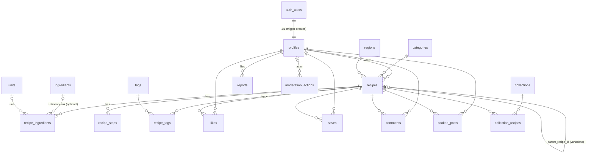

# Database

The source of truth for the data model. **Every schema change is a migration** in `supabase/migrations/`, with a pgTAP test in `supabase/tests/database/`. If this doc and the migrations disagree, the migrations win, and this doc gets fixed in the same change.

## 0. Status

| Area                                                                                                 | Status               | Migration                       |
| ---------------------------------------------------------------------------------------------------- | -------------------- | ------------------------------- |
| Schemas (`private`), extensions (`pg_trgm`, `unaccent`), enums `user_role`, `account_status`, `lang` | **Implemented (M1)** | `20261016080000_foundation.sql` |
| `profiles`, column grants, RLS, new-user trigger, role helpers, access-token hook                    | **Implemented (M1)** | `20261016080100_profiles.sql`   |
| Recipes, ingredients, steps, lookups, units, dictionary, storage buckets                             | Planned (M2)         | —                               |
| Search document, `search_recipes` RPC                                                                | Planned (M3)         | —                               |
| Likes, saves, comments, cooked posts, variations, collections                                        | Planned (M4)         | —                               |
| Reports, moderation actions, rate limits, posting passes, media trash                                | Planned (M6)         | —                               |

Everything from §2 on shows the **approved design**. Sections not yet implemented are marked _(planned)_.

## 1. Engine

- **Database:** PostgreSQL 17 (upstream `supabase/postgres` image).
- **Hosting:** self-hosted Docker. It also works on Supabase Cloud.
- **Local dev:** Supabase CLI (`pnpm db:start`). The ports are listed in `supabase/config.toml`.

**Implemented M1 specifics, beyond the outline below:**

- `profiles.onboarded_at` is set once the person confirms their handle and name.
- `profiles.handle` is unique and lower-case. The trigger derives it from the display name, falling back to `cook` or `cook_NNNN`, and **never from the email address**.
- Role helpers live in `private`:
  - `is_active()`, `has_role(min_role)`, `is_mod()` and `is_admin()` are `security definer` and `stable`. Policies call them as `(select private.…())`.
  - `is_active()` is true for `status = 'active'`, or for a suspension whose `suspended_until` has passed.
- The access-token hook is `private.custom_access_token_hook`. It is executable only by `supabase_auth_admin`. It adds `user_role` and `account_status` claims, which are **for the UI only**.
- Profile updates are limited by column grants to `handle`, `display_name`, `avatar_path`, `bio`, `district`, `preferred_lang`, `text_size` and `onboarded_at`.
- The first admin is set on the server with `deploy/scripts/promote-admin.sh <handle> admin`.

## 2. Conventions

- Postgres 17 (upstream `supabase/postgres` image). Extensions go in the `extensions` schema: `pg_trgm`, `unaccent`, `pg_cron`, `pg_net`.
- Tables are `snake_case` and plural. Primary keys are `id uuid default gen_random_uuid()`. Lookup tables use `smallint` or text codes. Foreign keys are `<thing>_id`. Timestamps are `created_at` and `updated_at timestamptz`, with `updated_at` maintained by a trigger.
- `public` schema = what PostgREST exposes, all with **RLS on**. `private` schema = helper functions and internal tables, not exposed.
- No soft delete for user content. Deletion really deletes, because users own their data. Moderation uses `mod_state = 'hidden'`, which is reversible.
- Counters (likes, saves, cooked, variations, comments) are kept on `recipes` by triggers, so cards never run `count(*)`.

## 3. ERD



## 4. Schema outline (planned except where §0 says implemented)

```sql
-- ── enums ─────────────────────────────────────────────
create type user_role       as enum ('user','moderator','admin');
create type account_status  as enum ('active','suspended');
create type lang            as enum ('ml','en');
create type recipe_status   as enum ('draft','published');
create type mod_state       as enum ('visible','hidden');
create type diet            as enum ('veg','egg','nonveg','vegan');
create type source_type     as enum ('manual','import','voice','scan');      -- voice/scan = v1.5
create type report_target   as enum ('recipe','comment','cooked_post','profile');
create type report_reason   as enum ('spam','offensive','harassment','copyright','unsafe','other');
create type report_status   as enum ('open','actioned','dismissed');
create type collection_kind as enum ('featured','festival','family_book');   -- family_book = v1.5

-- ── people ────────────────────────────────────────────
-- IMPLEMENTED (M1) — abbreviated; full definition in 20261016080100_profiles.sql
create table profiles (
  id              uuid primary key references auth.users on delete cascade,
  handle          text not null unique check (handle ~ '^[a-z0-9_]{3,30}$'),   -- /u/:handle
  display_name    text not null check (char_length(btrim(display_name)) between 1 and 60),
  avatar_path     text, bio text check (char_length(bio) <= 280),
  district        text check (district in ('tvm', …, 'ksd', 'other')),
  preferred_lang  lang not null default 'ml',
  text_size       text not null default 'normal' check (text_size in ('normal','large','xl')),
  onboarded_at    timestamptz,
  role            user_role not null default 'user',         -- not grantable to users
  status          account_status not null default 'active',  -- not grantable to users
  suspended_until timestamptz,
  created_at timestamptz not null default now(), updated_at timestamptz not null default now()
);
-- column-level grants: users may update ONLY these columns of their own row
grant select on profiles to anon, authenticated;
grant update (handle, display_name, avatar_path, bio, district, preferred_lang, text_size, onboarded_at)
  on profiles to authenticated;

-- PLANNED (M2+) from here on
-- ── lookups (seeded; ingredients admin-managed) ───────
create table categories (id smallint primary key, slug text unique not null, sort smallint not null, icon text);
create table regions    (id smallint primary key, slug text unique not null, grp text not null check (grp in ('kerala','india','world')));
create table tags       (id smallint generated always as identity primary key, slug text unique not null,
                         name_ml text not null, name_en text not null, kind text not null default 'general');  -- 'diet' kind = v2
create table units (
  code       text primary key,            -- glass, cup, tea_cup, ladle, pidi, pinch, tsp, tbsp, to_taste, g, kg, ml, l, piece, sprig, inch
  kind       text not null check (kind in ('volume','mass','count','vague')),
  scalable   boolean not null,            -- to_taste = false
  metric_ml  numeric, metric_g numeric,   -- approximate equivalents (glass ≈ 200 ml, pidi ≈ 30 g) — family-reviewed in M2
  is_traditional boolean not null default false
);
create table ingredients (
  id          int generated always as identity primary key,
  slug        text unique not null,                -- 'cumin'
  name_en     text not null,
  name_ml     text not null,                       -- 'ജീരകം'
  aliases     text[] not null default '{}',        -- Manglish + spellings: {'jeerakam','jeeragam','jeera'}
  grp         text,                                -- spice, vegetable, fish, …
  search_text text not null,                       -- trigger: manglish_norm(unaccent(all names + aliases))
  created_at timestamptz not null default now(), updated_at timestamptz not null default now()
);
create index on ingredients using gin (search_text extensions.gin_trgm_ops);

-- ── recipes ───────────────────────────────────────────
create table recipes (
  id               uuid primary key default gen_random_uuid(),
  author_id        uuid not null references profiles on delete cascade,
  slug             text not null,                     -- cosmetic; URL is /r/:id/:slug
  title_ml         text check (char_length(title_ml) <= 120),
  title_en         text check (char_length(title_en) <= 120),
  description      text check (char_length(description) <= 500),
  content_lang     lang not null,
  category_id      smallint references categories,
  region_id        smallint references regions,
  diet             diet,
  prep_minutes     smallint check (prep_minutes >= 0),
  cook_minutes     smallint check (cook_minutes >= 0),
  total_minutes    smallint generated always as (coalesce(prep_minutes,0) + coalesce(cook_minutes,0)) stored,
  servings         smallint check (servings between 1 and 200),
  yield_label      text check (char_length(yield_label) <= 40),   -- "pieces", "jar"
  cover_path       text,                                          -- null → category placeholder art
  tips             text check (char_length(tips) <= 2000),
  status           recipe_status not null default 'draft',
  mod_state        mod_state not null default 'visible',          -- moderators only (RPC)
  source_type      source_type not null default 'manual',
  source_url       text,                                          -- imports: link only, never prose/photos
  parent_recipe_id uuid references recipes on delete set null,    -- variations
  is_variation     boolean not null default false,                -- true + null parent = "original removed"
  like_count int not null default 0, save_count int not null default 0, cooked_count int not null default 0,
  variation_count int not null default 0, comment_count int not null default 0,
  search_vector    tsvector,   -- trigger: titles (A), ingredient names ml+en+aliases (B), tags (B), description (C)
  search_text      text,       -- trigger: manglish_norm'd titles + ingredients + tags, for trigram
  published_at timestamptz, created_at timestamptz not null default now(), updated_at timestamptz not null default now(),
  -- publishing requires the essentials; drafts may be incomplete
  constraint publishable check (status = 'draft' or (
    coalesce(title_ml, title_en) is not null and category_id is not null and diet is not null and servings is not null))
);
create index recipes_feed   on recipes (published_at desc) where status = 'published' and mod_state = 'visible';
create index on recipes (author_id, updated_at desc);
create index on recipes (category_id) where status = 'published';
create index on recipes (parent_recipe_id) where parent_recipe_id is not null;
create index on recipes using gin (search_vector);
create index on recipes using gin (search_text extensions.gin_trgm_ops);

create table recipe_ingredients (
  id uuid primary key default gen_random_uuid(),
  recipe_id     uuid not null references recipes on delete cascade,
  position      smallint not null,
  group_label   text,               -- "For grinding", "For tempering"
  amount        numeric(10,3),      -- null for "to taste"
  amount_max    numeric(10,3),      -- ranges: 2–3
  unit_code     text references units,
  ingredient_id int references ingredients on delete set null,
  item_text     text not null check (char_length(item_text) <= 120),   -- as the author typed it
  note          text check (char_length(note) <= 120),                 -- "finely chopped"
  unique (recipe_id, position)
);
create index on recipe_ingredients (ingredient_id);

create table recipe_steps (
  id uuid primary key default gen_random_uuid(),
  recipe_id     uuid not null references recipes on delete cascade,
  position      smallint not null,
  body          text not null check (char_length(body) <= 2000),
  photo_path    text,
  timer_seconds int check (timer_seconds between 1 and 86400),   -- auto-detected, author confirms
  unique (recipe_id, position)
);
create table recipe_tags (recipe_id uuid references recipes on delete cascade, tag_id smallint references tags,
                          primary key (recipe_id, tag_id));

-- ── community ─────────────────────────────────────────
create table likes (user_id uuid references profiles on delete cascade, recipe_id uuid references recipes on delete cascade,
                    created_at timestamptz not null default now(), primary key (user_id, recipe_id));
create index on likes (recipe_id, created_at);        -- "popular this week"
create table saves (user_id uuid references profiles on delete cascade, recipe_id uuid references recipes on delete cascade,
                    created_at timestamptz not null default now(), primary key (user_id, recipe_id));
create table comments (
  id uuid primary key default gen_random_uuid(),
  recipe_id uuid not null references recipes on delete cascade,
  author_id uuid not null references profiles on delete cascade,
  body text not null check (char_length(body) between 1 and 1000),
  mod_state mod_state not null default 'visible',
  created_at timestamptz not null default now(), edited_at timestamptz
);
create index on comments (recipe_id, created_at);
create table cooked_posts (
  id uuid primary key default gen_random_uuid(),
  recipe_id uuid not null references recipes on delete cascade,
  author_id uuid not null references profiles on delete cascade,
  photo_path text not null,
  note text check (char_length(note) <= 140),
  mod_state mod_state not null default 'visible',
  created_at timestamptz not null default now()
);
create index on cooked_posts (recipe_id, created_at desc);
create index on cooked_posts (author_id, created_at desc);

-- ── curation (featured row now; festivals/family books v1.5) ──
create table collections (
  id uuid primary key default gen_random_uuid(),
  kind collection_kind not null, slug text unique not null,
  title_ml text, title_en text, description text,
  owner_id uuid references profiles on delete cascade,   -- null = site collection
  is_public boolean not null default true,
  starts_on date, ends_on date,                           -- seasonal (Onam, Vishu…)
  sort smallint not null default 0, created_at timestamptz not null default now()
);
create table collection_recipes (collection_id uuid references collections on delete cascade,
  recipe_id uuid references recipes on delete cascade, position smallint not null, primary key (collection_id, recipe_id));

-- ── trust ─────────────────────────────────────────────
create table reports (
  id uuid primary key default gen_random_uuid(),
  reporter_id uuid not null references profiles on delete cascade,
  target_type report_target not null, target_id uuid not null,   -- polymorphic; trigger checks the target exists
  reason report_reason not null, details text check (char_length(details) <= 500),
  status report_status not null default 'open',
  resolved_by uuid references profiles on delete set null, resolved_at timestamptz, resolution_note text,
  created_at timestamptz not null default now(),
  unique (reporter_id, target_type, target_id)                     -- one report per person per thing
);
create index on reports (status, created_at) where status = 'open';
create index on reports (target_type, target_id);
create table moderation_actions (                                   -- append-only audit log
  id bigint generated always as identity primary key,
  actor_id uuid references profiles on delete set null,
  action text not null check (action in ('hide','restore','delete','suspend','unsuspend','set_role','auto_hide','feature','unfeature')),
  target_type text not null, target_id uuid not null, reason text,
  created_at timestamptz not null default now()
);

-- ── private (not exposed by PostgREST) ────────────────
create table private.posting_passes (user_id uuid primary key references auth.users on delete cascade, valid_until timestamptz not null);
create table private.media_trash   (path text primary key, bucket text not null, queued_at timestamptz not null default now());
```

**Key functions** (all in `private`, `security definer`, `set search_path = ''`):

| Function                                                                                                                                                      | Purpose                                                                                                                                                                                                    |
| ------------------------------------------------------------------------------------------------------------------------------------------------------------- | ---------------------------------------------------------------------------------------------------------------------------------------------------------------------------------------------------------- |
| `handle_new_user()`                                                                                                                                           | Trigger on `auth.users`. Creates a profile with a generated unique handle, taking the language from sign-up metadata.                                                                                      |
| `custom_access_token_hook(event)`                                                                                                                             | Adds `user_role` and `account_status` claims to the JWT. These are **for the UI only**. RLS reads the authoritative values, so a suspension takes effect immediately rather than when the token refreshes. |
| `is_active()`, `is_mod()`, `is_admin()`                                                                                                                       | Read `profiles` for `auth.uid()`. Policies call them as `(select private.is_mod())` so they're evaluated once per statement.                                                                               |
| `can_read_recipe(id)`                                                                                                                                         | `(published and visible) or owner or mod`. Used by every child-table policy.                                                                                                                               |
| `enforce_rate_limit(action)`                                                                                                                                  | Called from `before insert` triggers. Counts the user's own recent rows. Limits are lower in an account's first 7 days (see the table below).                                                              |
| `require_posting_pass()`                                                                                                                                      | Requires a valid Turnstile pass (30 minutes) before publishing a recipe, a cooked-it post or a comment.                                                                                                    |
| `report_auto_hide()`                                                                                                                                          | Trigger on `reports`. When 3 distinct reporters have open reports on one target, sets `mod_state = 'hidden'` and logs an `auto_hide` action.                                                               |
| `bump_counters()`                                                                                                                                             | Triggers on likes, saves, comments, cooked posts and variations.                                                                                                                                           |
| `refresh_search(recipe_id)`                                                                                                                                   | Rebuilds `search_vector` and `search_text` whenever a recipe, its ingredients or its tags change.                                                                                                          |
| `manglish_norm(text)`                                                                                                                                         | Immutable. Mirrors `packages/core/manglish.ts`. Unit tests in both places share the same fixture file.                                                                                                     |
| `search_recipes(q, category, diet, max_minutes, region, limit, cursor)`                                                                                       | `stable` RPC (see §7).                                                                                                                                                                                     |
| `make_variation(source_id)`                                                                                                                                   | Copies a recipe with its ingredients, steps and tags into a draft for the caller, with `parent_recipe_id` and `is_variation` set.                                                                          |
| `mod_set_state(target_type, id, state, reason)`, `mod_suspend(user_id, until, reason)`, `admin_set_role(user_id, role)`, `admin_feature(recipe_id, position)` | Moderation RPCs. Each one checks the caller's role and writes to `moderation_actions`.                                                                                                                     |

**Rate limits** (Postgres side, per user, starting values for you to tune):

| Action                  | Limit, first 7 days | Limit afterwards |
| ----------------------- | ------------------- | ---------------- |
| Publish recipe          | 3 / day             | 20 / day         |
| Comment                 | 10 / hour           | 30 / hour        |
| Cooked-it post          | 5 / day             | 20 / day         |
| Report                  | 10 / day            | 10 / day         |
| Uploads (to `incoming`) | 30 / hour           | 60 / hour        |

Sign-up and auth emails are limited by GoTrue's own `GOTRUE_RATE_LIMIT_*` settings, plus GoTrue's **native Turnstile captcha** on sign-up and password reset. Traefik adds a per-IP limit in front of everything.

## 5. RLS policy matrix

`anon` means a visitor who isn't signed in. "Own" means `author_id` (or `user_id`) equals `auth.uid()`, and every write also requires `is_active()`.

| Table                             | select                                  | insert                                  | update                                         | delete                    |
| --------------------------------- | --------------------------------------- | --------------------------------------- | ---------------------------------------------- | ------------------------- |
| profiles                          | everyone (public columns)               | trigger only                            | own (granted columns only)                     | via `delete-account` only |
| recipes                           | `can_read_recipe`                       | own                                     | own (except `mod_state`/counters: not granted) | own · admin               |
| recipe_ingredients / steps / tags | `can_read_recipe(recipe_id)`            | owner of recipe                         | owner of recipe                                | owner of recipe           |
| categories, regions, units, tags  | everyone                                | admin                                   | admin                                          | admin                     |
| ingredients                       | everyone                                | admin                                   | admin                                          | admin                     |
| collections / collection_recipes  | `is_public` or owner or admin           | admin (owner in v1.5)                   | admin                                          | admin                     |
| likes                             | own                                     | own, recipe readable and published      | —                                              | own                       |
| saves                             | own                                     | own, recipe readable                    | —                                              | own                       |
| comments                          | visible and recipe readable · own · mod | own + posting pass + rate limit         | own (`body` only; sets `edited_at`)            | own · mod                 |
| cooked_posts                      | visible and recipe readable · own · mod | own + posting pass + rate limit         | own (`note` only)                              | own · mod                 |
| reports                           | mod                                     | own (`reporter_id = uid`), rate limited | mod (via RPC)                                  | —                         |
| moderation_actions                | mod                                     | RPC only                                | —                                              | —                         |

**pgTAP tests** run against every row in this table, from four viewpoints: anon, another user, the owner, and a moderator. They also cover suspended users and drafts. Expected denials are tests too.

## 6. v1.5 / v2 fit (nothing in v1 needs reworking)

| Future feature             | Where it fits                                                                                                                     |
| -------------------------- | --------------------------------------------------------------------------------------------------------------------------------- |
| Voice entry                | `source_type = 'voice'`, `ai-transcribe` and `ai-structure` functions behind `packages/core/ai`, transient private `voice` bucket |
| Heritage card scan         | `source_type = 'scan'`, `recipe_attachments(recipe_id, path, kind)` table, private `scans` bucket                                 |
| Family books               | `collections.kind = 'family_book'`, `owner_id`, `is_public = false`, plus a `collection_members` table                            |
| Festival planner           | `collections.kind = 'festival'` with `starts_on`/`ends_on`, plus the existing core scaler multiplied by number of guests          |
| Diet tags                  | `tags.kind = 'diet'`                                                                                                              |
| Pantry ("what can I cook") | `recipe_ingredients.ingredient_id`, which is already structured                                                                   |
| Meal planner               | new `meal_plans` / `meal_plan_items` tables                                                                                       |
| Variation change history   | new `recipe_revisions` table                                                                                                      |

## 7. How search works (planned, M3)

1. Normalise the query with `manglish_norm(unaccent(lower(q)))`.
2. Match dictionary ingredients with trigram `word_similarity` ≥ 0.4 on `ingredients.search_text`. This catches "jeeragam", "jeerakam", "ജീരകം" and "cumin".
3. Find recipes that match either way:
   - `search_vector @@ websearch_to_tsquery(...)`, **or**
   - trigram similarity on `search_text`, **or**
   - an ingredient matched in step 2.
4. Rank by FTS rank, plus trigram score, plus a bonus for ingredient matches, plus a small boost for popularity.
5. Apply the filters as plain `where` clauses. Page with a keyset cursor.

Target: p95 under 200 ms on the seed data scaled to about 1,200 recipes.

---

## 8. Migration rules

Every schema change must:

1. be a new timestamped file in `supabase/migrations/`. Applied migrations are never edited.
2. enable RLS and add **explicit grants** for any new table. `auto_expose_new_tables = false`, so nothing is granted by default.
3. come with pgTAP tests for every policy, from four viewpoints: anon, another user, the owner and a moderator. That includes the expected denials. `01_rls_coverage.test.sql` fails if any `public` table lacks RLS.
4. pass `pnpm test:db` and `pnpm db:lint` locally and in CI.
5. never break existing production data. Destructive changes (drop, rename, type narrowing) go in two steps (expand, then contract) and are reviewed before they run.
6. update this doc's status table and the relevant sections.

## 9. Seed data

`supabase/seed.sql` is generated from `supabase/seed/` (starting in M2):

- about 12 original sample recipes (Kerala and others, ml + en, written for this project),
- demo users with known dev-only passwords,
- the starter dictionary of about 150 ingredients (ml, en and Manglish aliases),
- the units table with approximate metric equivalents.

Seed data is for local dev and staging only and is never loaded in production.
